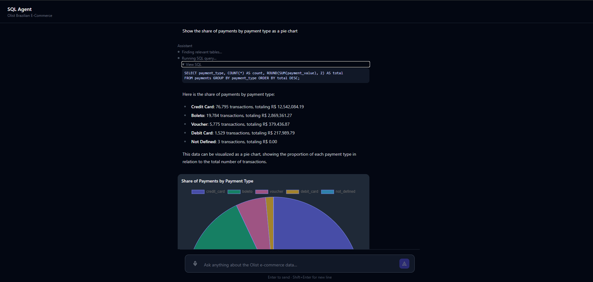
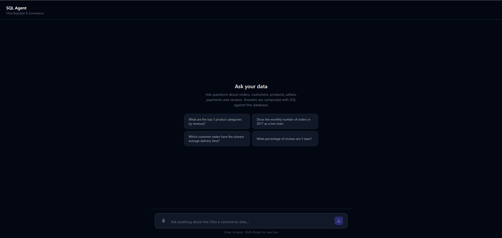
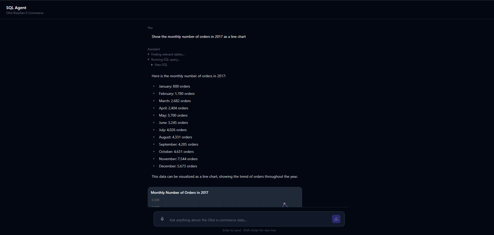
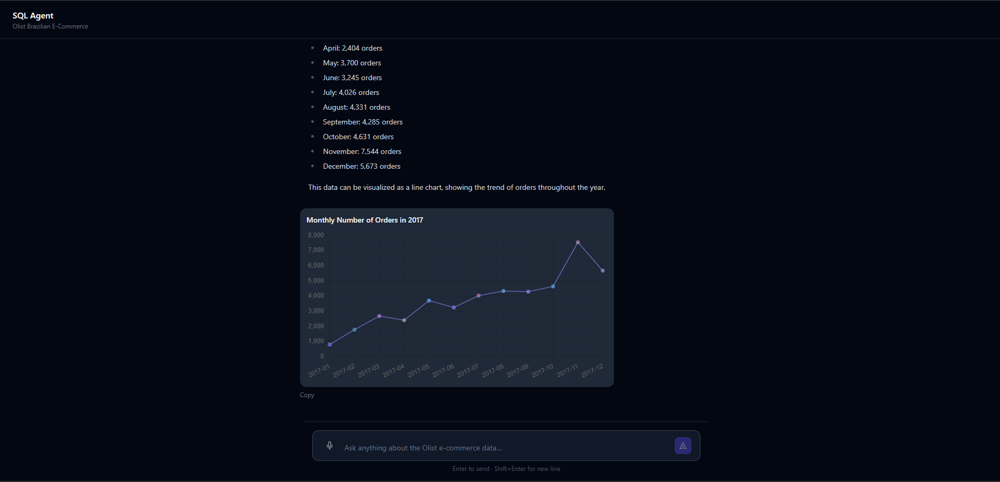
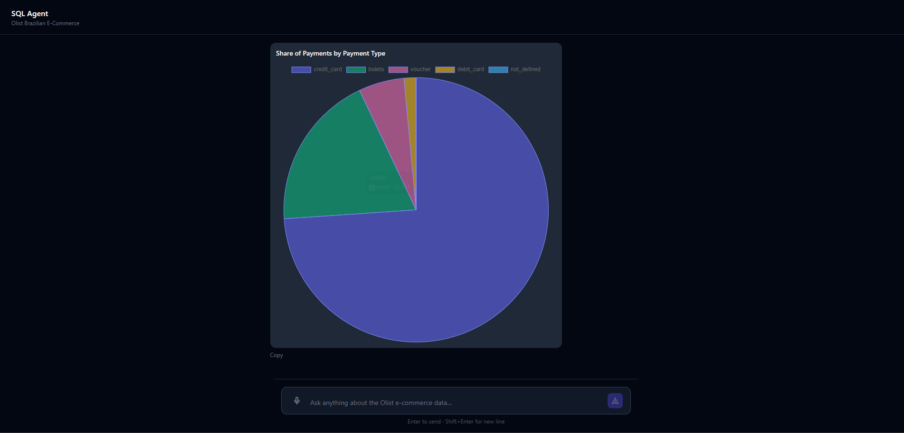
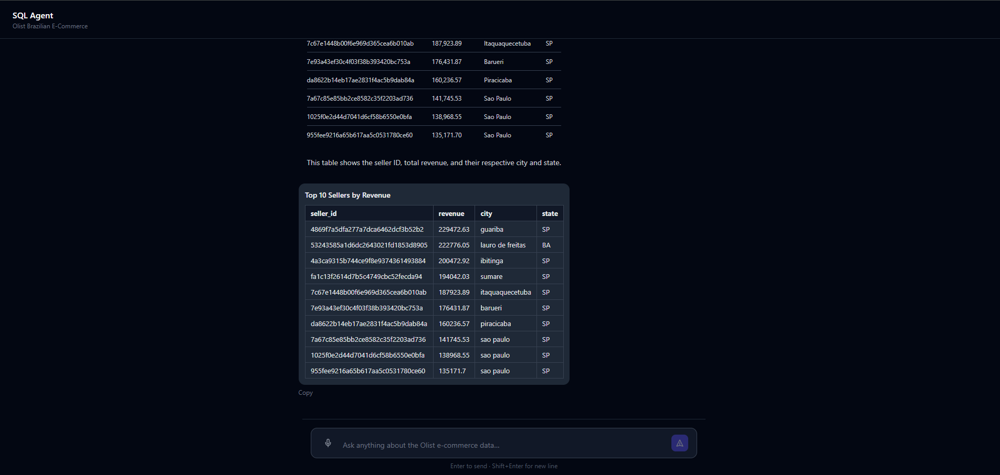
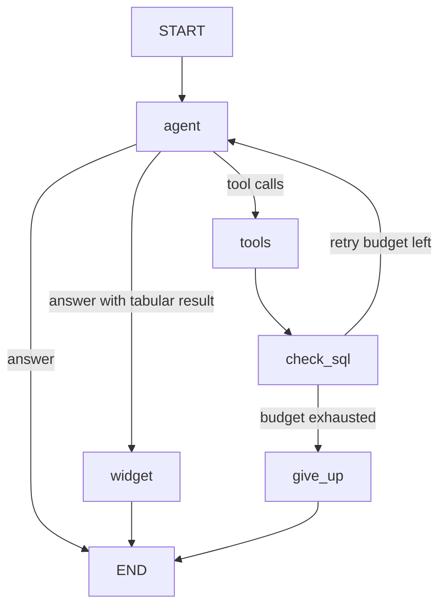

# LangGraph SQL Agent

Ask questions about an e-commerce database in plain English and get streamed
answers, charts and tables, all computed with real SQL.

Built with **LangGraph**, **FastAPI**, **PostgreSQL + pgvector** and **React**,
traced end to end with **LangSmith**.



## Features

- **Agentic text-to-SQL** — a LangGraph loop: retrieve schema → write SQL → execute → answer
- **Schema retrieval with pgvector** — table descriptions and example queries retrieved by semantic similarity, so the model writes queries with the correct column names
- **Self-correcting SQL** — a failed query is retried with the database error, bounded by a retry budget, then a clear "could not answer" instead of a guess
- **Streaming UI** — answer tokens, agent progress steps and the executed SQL stream over Server-Sent Events
- **Grounded charts** — the model chooses the chart type and columns; the values come from the query result, so a chart cannot show a number the database did not return
- **Conversation memory** — multi-turn threads persisted by a Postgres checkpointer, including tool calls and query results
- **Stop generation** — cancels the running graph, keeps the partial answer and leaves the thread usable
- **Database-enforced safety** — a read-only role with table-scoped grants and a statement timeout, on top of application-level validation
- **Voice input** — browser speech recognition fills the message box

## Screenshots

Starting point, with suggested questions:



A question answered with progress steps, the streamed answer and a chart:



Charts are built from the query result, so the values always match the database:





Results with several columns render as a table:



## Architecture

```
React (Vite) ──SSE──► FastAPI ──► LangGraph agent
                                    │
          ┌─────────────────────────┼──────────────────────────┐
          ▼                         ▼                          ▼
   retrieve_schema              run_sql                    widget node
  (pgvector search)      (agent_readonly role)        (structured output)
          │                         │                          │
          └────────► PostgreSQL 16 + pgvector ◄── checkpointer ─┘
                                    │
                         LangSmith (tracing)
```

Agent graph:



## Tech Stack

| Layer | Technology |
|---|---|
| Agent | LangGraph, LangChain, OpenAI `gpt-4o-mini` |
| Retrieval | `text-embedding-3-small` (512 dims), pgvector |
| API | FastAPI, Server-Sent Events, psycopg 3 |
| Database | PostgreSQL 16, LangGraph Postgres checkpointer |
| Observability | LangSmith |
| Frontend | React, TypeScript, Vite, Tailwind CSS, Chart.js in sandboxed iframes |
| Tooling | uv, Docker Compose |

## Dataset

[Olist Brazilian E-Commerce](https://www.kaggle.com/datasets/olistbr/brazilian-ecommerce):
about 100k orders from 2016 to 2018 across customers, orders, order items,
products, sellers, payments and reviews (~550k rows).

## Getting Started

**Prerequisites:** Docker, Python 3.13 with [uv](https://docs.astral.sh/uv/),
Node 18+, an OpenAI API key, and a LangSmith API key for tracing (optional).

### 1. Data

Download the dataset from Kaggle and extract the CSV files directly into `data/`.

### 2. Database

```bash
docker compose up -d
```

### 3. Backend

```bash
cd backend
cp .env.example .env        # add OPENAI_API_KEY and LANGSMITH_API_KEY
uv sync
uv run python -m db.setup   # creates tables, loads the data, creates the read-only role, embeds schema memory
uv run uvicorn app.main:app --reload
```

On Windows, add `--loop asyncio:SelectorEventLoop` to the `uvicorn` command.

### 4. Frontend

```bash
cd frontend
npm install
npm run dev
```

Open http://localhost:5173.

### Command line

```bash
cd backend
uv run python -m scripts.ask "Which seller generated the most revenue?"
uv run python -m scripts.ask --mermaid
```

## Example Questions

- What are the top 5 product categories by revenue?
- Show the monthly number of orders in 2017 as a line chart.
- Which customer states have the slowest average delivery time?
- Show the payment type breakdown as a table.
- How many orders were delivered later than estimated?
- What percentage of reviews are 5 stars?

## How It Works

1. **Retrieval.** The question is embedded and matched against table descriptions
   and example query pairs stored in pgvector, so only the relevant schema
   reaches the model.
2. **SQL generation and execution.** The model writes a single `SELECT`, which is
   validated and executed as the `agent_readonly` role. Results are capped at 100 rows.
3. **Self-correction.** A failed query returns the database error to the model,
   which rewrites it. After three failed attempts the agent stops and says so.
4. **Answer and visualization.** The answer streams token by token. When the
   result has several rows and columns, a widget node picks a chart type and
   columns, and the server builds the chart from the query result.
5. **Memory.** Every step is checkpointed in Postgres under a thread id, so
   follow-up questions can refer to earlier results.

## Security

- The agent connects as `agent_readonly`: `SELECT` on the dataset tables only,
  read-only transactions, a 5-second statement timeout and no superuser rights.
  Application tables and conversation history are not readable by the agent.
- Application-level validation rejects non-`SELECT` and multi-statement queries
  before execution, and returns a readable error to the model.
- Widgets render in sandboxed iframes without same-origin access, and all values
  are HTML-escaped.
- API keys stay server-side; `.env` is not committed.

## Project Structure

```
backend/
  agent/     graph, tools, retrieval, prompts, widgets
  app/       FastAPI app, SSE streaming, routes
  db/        schema and one-command setup
  scripts/   command-line interface
frontend/    React UI
```
